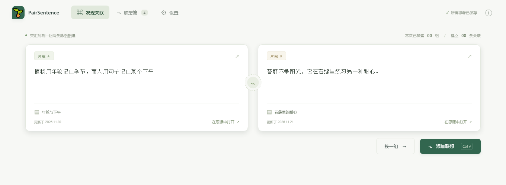
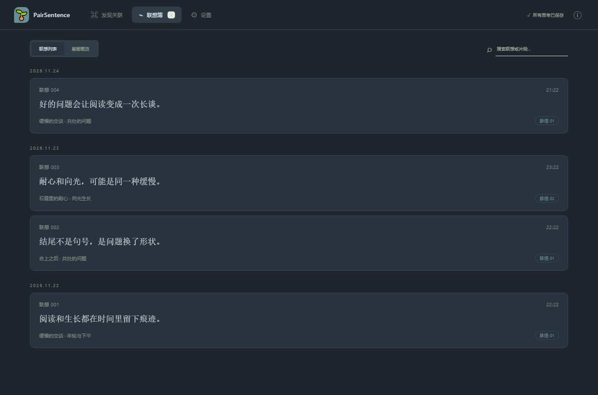
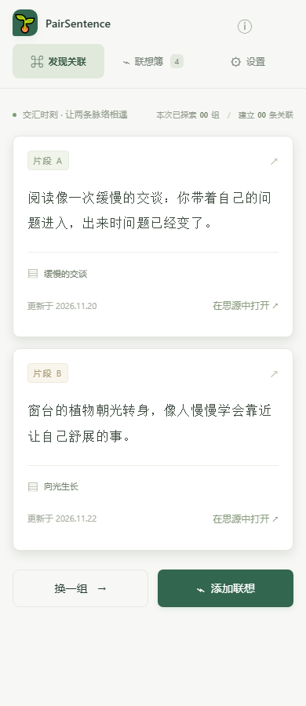
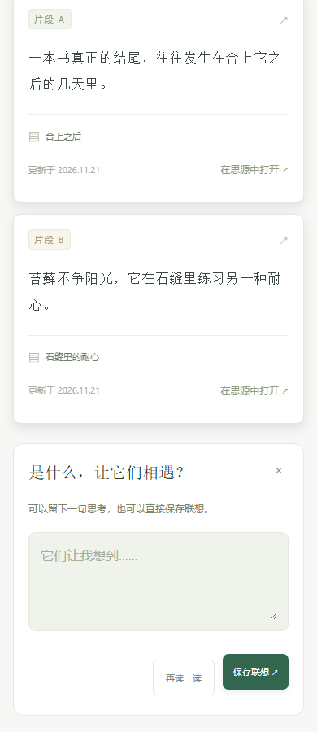

# PairSentence

Meet two note blocks at random.

> One way to use it: read the two blocks and ask whether they are related, why, and in what way. Write it down, or shuffle to another pair. Later, revisit those records to expand, continue, discuss further, or remove them.

Where is your data, and is it safe? Everything is stored as JSON under `data/storage/petal/pairsentence/`, and uninstalling the plugin will not lose it.

## Gallery

It also works on mobile.

  
  

