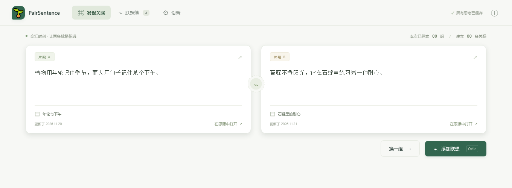
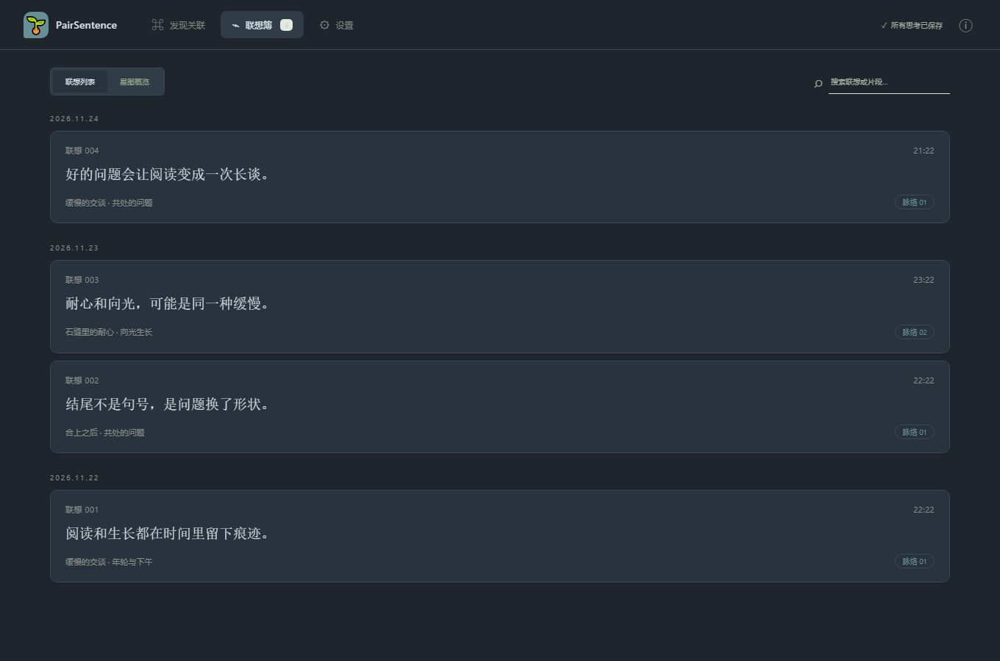
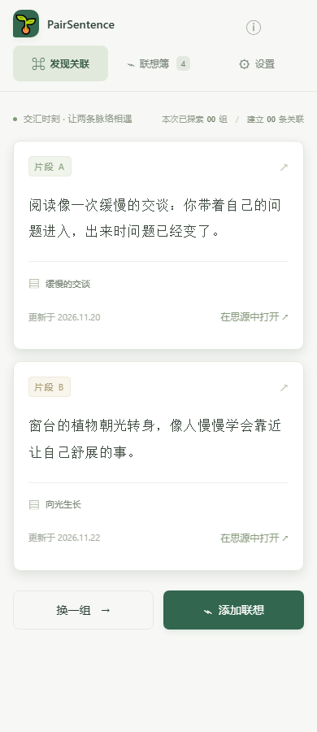
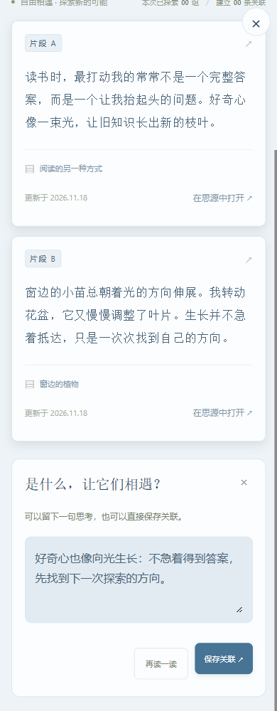

# PairSentence

随机遇见两个笔记片段，阅读、联想、建立关联，再回顾自己的思考。

## 用例

以下截图中的笔记与思考均为虚构演示内容。

**让连接长成脉络。** 回顾片段与思考，逐渐看见自己的想法如何相连。

在手机上也能用。

  
  

> 数据以JSON存储在`data/storage/petal/pairsentence/`。

[安装、同步与备份说明](docs/Document.md) · [发布与更新指南](docs/RELEASING.md)
