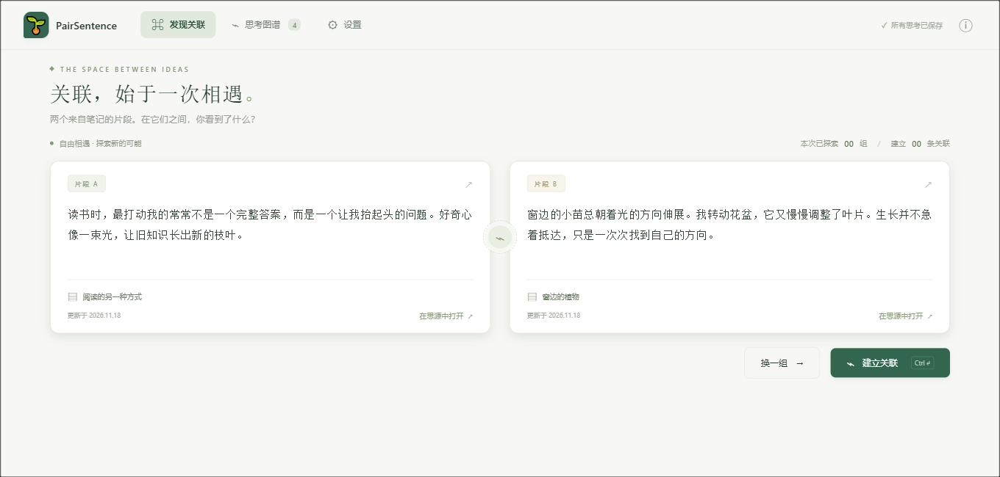
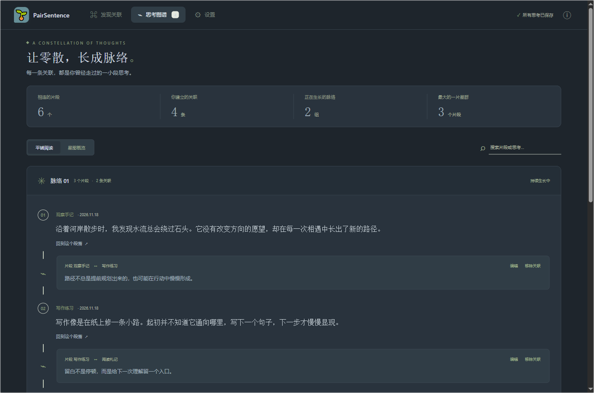
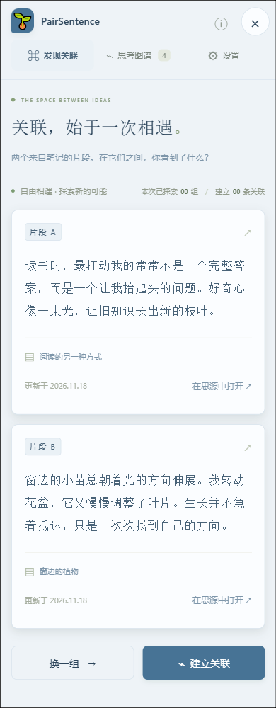
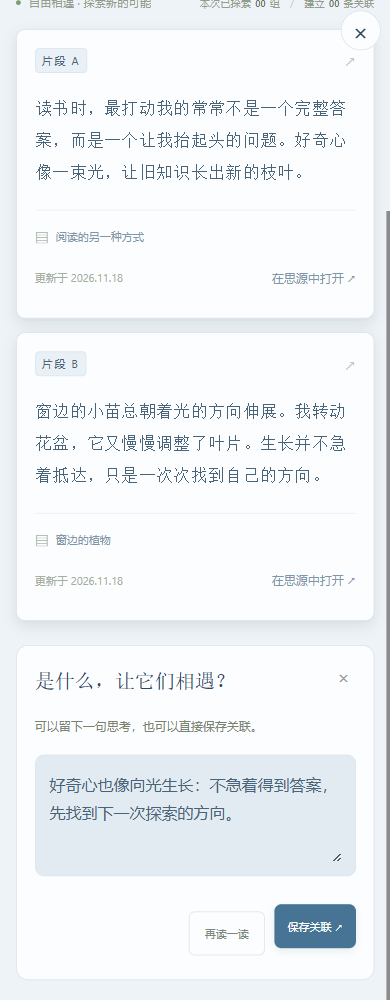

# PairSentence

Discover connections between fragments in your current SiYuan workspace. Link two paragraphs, record a thought, and revisit your connections as a reading view or constellation.

## A glimpse of PairSentence

These images render the plugin UI with entirely fictional notes, connections and thoughts. No personal notebook data is used. The phone images illustrate the narrow-screen layout.

Read two fragments and discover a connection:

Revisit the paths between your ideas:

Read and write on your phone, with thoughts expanded in the page:

  
  

Copy the built `pairsentence` directory into your workspace's `data/plugins/`, enable the plugin in SiYuan, and click its 🌱 launcher. No API token or external server is required. Desktop, mobile and browser frontends are targeted; minimum declared SiYuan version: 3.8.5.

Desktop frontends use a launcher in the right sidebar to open a native SiYuan tab; clicking the icon again returns to it. Mobile frontends keep the top-bar entry and use a full-screen view.

Graph and preferences live in `data/storage/petal/pairsentence/` and use SiYuan workspace synchronization. Finish synchronization on the old device, synchronize the new device, then open the plugin. This version assumes one person using one device at a time. A local save is not confirmation that cloud synchronization has finished.

Export or import JSON backups in Settings. Imports replace the current graph, so export a backup first. If fragments are absent from the current workspace, their connections become unavailable after verification; saved thoughts remain in the graph. Connections recover when fragments with the same IDs return.

Run `npm run build:plugin` from the project root to produce `dist/pairsentence/` and `dist/package.zip`. Published builds are available on GitHub Releases; the marketplace submission is under review. Source: https://github.com/mnyon/pairsentence. Code: MIT. Icon: Twemoji, CC BY 4.0 (see THIRD-PARTY-NOTICES.md). Desktop/mobile/sync acceptance testing is required before publication.

See [简体中文说明](README.zh-CN.md) for details.

The reading view offers two choices: next pair or create a connection. An optional thought can be entered after choosing to connect. Passing a pair gradually reduces that combination's frequency without quarantining either fragment.

Normal uninstall preserves graph, thoughts and preferences in `data/storage/petal/pairsentence/`. Reinstalling the same plugin in the same workspace reads them again. Manually deleting that directory removes the saved records. Export a JSON backup before uninstalling; it contains the graph and thoughts, not UI preferences. Unsubmitted drafts are not saved. Original SiYuan notes are unaffected.

