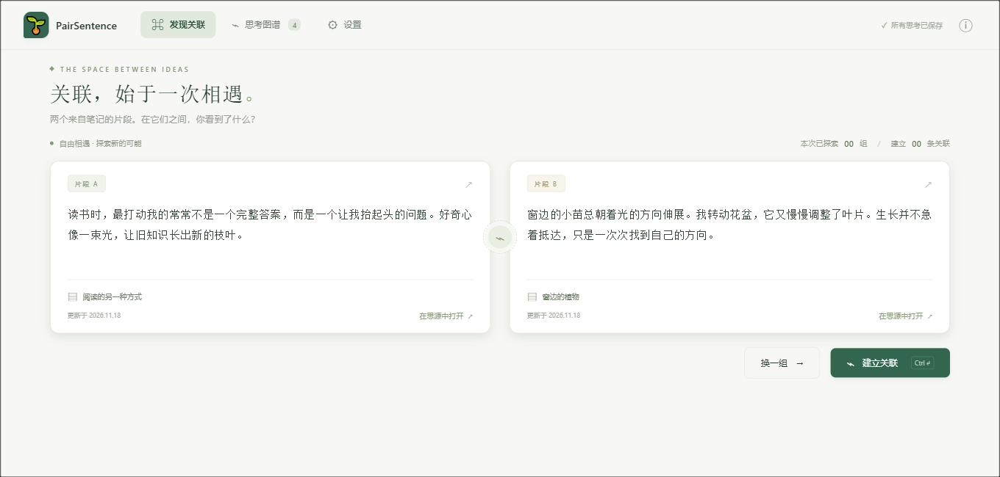
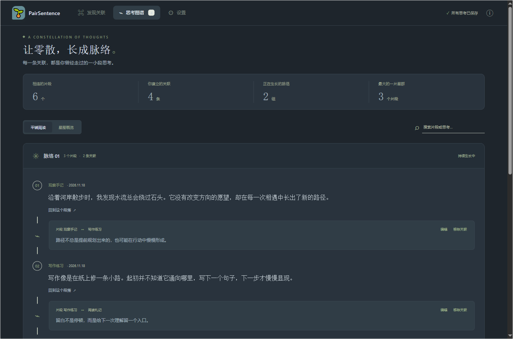
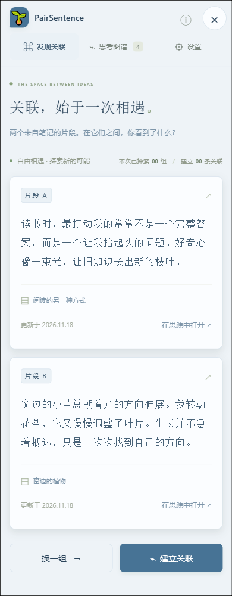

# PairSentence

让当前思源工作空间里的两个笔记片段相遇，建立关联，留下一句思考，再以平铺阅读或星图回顾。

## 看看 PairSentence

以下图片使用插件实际界面渲染，所有笔记、关联和思考均为虚构演示内容，不含私人数据。

**让两段笔记相遇。** 读一读，换一组，或为它们建立关联。

**让连接长成脉络。** 回顾片段与思考，逐渐看见自己的想法如何相连。

**在手机上，也能慢慢读、轻轻记。** 两段原文上下排列，思考在页内展开，随时可以回看。

  
  

## 安装

1. 将 `dist/pairsentence` 整个文件夹复制到思源工作空间的 `data/plugins/` 下，最终应为 `data/plugins/pairsentence/plugin.json`。
2. 在思源的插件集市「已下载」中启用插件；必要时重启思源。
3. 桌面端点击默认位于右侧栏的 🌱 图标，在思源原生页签中打开，重复点击切回已有页签。手机端保留顶栏入口并打开全屏视图。无需地址或 API Token。

本版本最低声明支持思源 3.8.5。移动端使用前，请确认插件文件已同步或安装，并在该设备启用插件。`package.zip` 是标准插件包，可供后续 Release 分发；集市收录申请正在审核中。

## 多设备同步

图谱保存于 `data/storage/petal/pairsentence/graph.json`，配色、动画及专注偏好保存于同目录的 `preferences.json`，随思源工作空间数据同步。请在思源内配置并启用数据同步。

换设备的顺序：在原设备完成操作和思源同步 → 在新设备完成思源同步 → 打开 PairSentence。收到插件数据变更通知后会重新读取；有未提交的思考或编辑时先保留输入，完成或清空后重新打开插件。仅支持单人、同一时间在一个设备操作，不合并同时发生的修改。界面「已保存」指已保存到当前思源工作空间，不代表云端同步已经完成。

## 数据与备份

在顶部「设置」页的「数据与备份」中导出或导入 JSON 备份。导入会替换当前图谱，核对数量后再确认，建议先导出当前备份。

「设置」页也集中提供配色、动效选择及预览。配色默认跟随思源启动时的亮暗模式（亮色使用青苔，暗色使用夜读）；已有手动配色继续保留，可选择「跟随思源」恢复默认。动效包括共振、星火、生长、翻页和静谧，预览不会创建关联，并遵循系统的减少动态效果偏好。

若片段不在当前工作空间中，确认缺失后对应关联将暂不可用，片段快照与思考记录仍保存在图谱数据中。相同 ID 的片段恢复后，关联也会恢复。建议保留原始备份。

## 使用与数据

- 打捞最多 160 个正文超过 15 字符的段落。主界面只有「换一组」和「建立关联」；建立关联后可选填思考，或直接保存。保留撤销与图谱编辑。
- 换组只表示这次没有连接，不惩罚任何一个片段。重复换走的组合会逐渐减少出现，片段仍可与其他笔记相遇。
- 只读取笔记，不改动思源原文；建立关联只写入插件图谱。
- 手机收起或桌面关闭页签保留未提交输入，隐藏时停止定时查询；禁用或重启插件会丢失未提交输入。
- 图谱导出包含笔记正文和思考，请自行保管。插件不会将图谱提交到公开仓库或发布服务。

## 卸载与数据保留

普通卸载会移除插件文件，保留工作空间中 `data/storage/petal/pairsentence/` 内的图谱、思考和设置。在同一工作空间重新安装此插件后，可以继续读取这些数据。禁用插件同样不会删除已保存的数据。

手动删除该数据目录或清理整个工作空间会丢失插件记录，重新安装无法凭空恢复；需要从备份导入。卸载前建议在「设置 → 数据与备份」导出 JSON。JSON 包含图谱及思考，不包含配色等界面偏好。未提交的输入不会保存。上述操作不改动思源笔记原文。

## 构建与发布准备

在项目根目录执行 `npm run build:plugin`，无需安装构建依赖，输出 `dist/pairsentence/` 和 `dist/package.zip`。修改源文件后重新构建，不要编辑生成文件。

当前为本地安装候选包，集市收录申请正在审核中。代码采用 MIT 许可，图标采用 Twemoji（CC BY 4.0，见 THIRD-PARTY-NOTICES.md）。正式发布前需完成真实桌面、手机及两设备同步验收，再创建正式 GitHub Release 并申请集市收录。公开源码：https://github.com/mnyon/pairsentence。

## 手机阅读

手机上导航分为两行，两个片段上下排列。图谱统计以两列显示，星图可左右滑动；设置、备份和思考输入适配窄屏与触控。当前已做浏览器手机尺寸检查，仍需在真实思源手机端验证软键盘、系统返回、段落跳转和同步。

手机建立关联时，在原页面展开选填思考区，可随时滚动回看两个片段；不会自动弹出键盘，也可直接保存关联。
